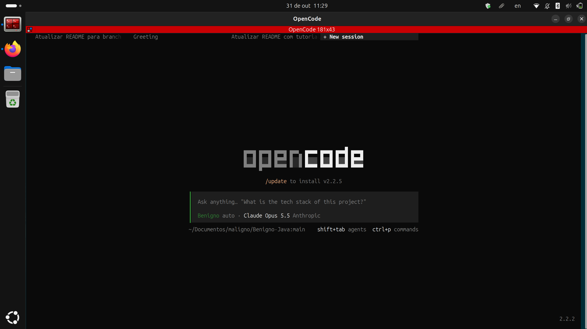

# O Benigno 

O Benigno é um agente do **OpenCode** que escreve e revisa trabalhos de Java no padrão exato que o professor Maligno cobra: não só código que funciona, mas código que o professor *espera* ver para dar a nota máxima.

## Como funciona

Todo o material (apostila, caderno, exemplos, provas, trabalho) foi lido **uma vez** e destilado em **36 subagentes especialistas** (`maligno/*`), cada um com as regras e os trechos de código do professor sobre um único tema.

```
benigno (principal) ──► subagentes maligno/* ──► (último caso) 1 arquivo de Materias de aula/
```

1. O `benigno` classifica o pedido e consulta **só** os subagentes necessários, em paralelo.
2. Os subagentes não têm ferramentas: respondem com o conhecimento embutido, no formato `REGRA / CÓDIGO / FONTE / ALERTAS`.
3. Se um tema não estiver coberto, o subagente responde `NAO_COBERTO` apontando **um arquivo**; só então o `benigno` o lê.

## Passo a passo para usar o Benigno

Não há prompt para colar nem configuração global: o `opencode.json` da raiz define o `benigno` como agente padrão e carrega o plugin `ponytail`, e os agentes ficam em `.opencode/agents/`. O que você precisa fazer manualmente:

### 1. Ter o OpenCode, um modelo de IA, o Git e o JDK
Confira o que já está instalado:
```bash
opencode --version   # precisa ser 2.x
git --version
javac -version       # JDK 8 ou superior
```
Faltou algo? Siga as subseções abaixo. Já tem tudo e um modelo configurado? Pule para o passo 2.

#### 1.1 Instalar o OpenCode V2
- **Linux / macOS / WSL:**
  ```bash
  curl -fsSL https://opencode.ai/v2/install | bash
  ```
  Alternativas: `npm install -g @opencode/cli` (se já tiver Node.js) ou `brew install anomalyco/tap/opencode-v2` (macOS).
- **Windows:** gerenciadores de pacote do Windows não são suportados. Use o **WSL** (comando acima dentro do Ubuntu do WSL), o [binário x64](https://opencode.ai/update/api/latest/cli/opencode/opencode-windows-x64.zip) ou o [app Desktop](https://opencode.ai/update/api/latest/desktop/opencode/opencode-desktop-win-x64.exe).
- **Prefere janela a terminal?** Há o app Desktop para todos os sistemas: links em <https://opencode.ai/v2/docs/>.

Depois de instalar, **feche e abra o terminal** e rode `opencode --version` de novo.

#### 1.2 Conectar um modelo de IA
O Benigno não traz modelo próprio: ele usa o modelo selecionado na sessão do OpenCode. Escolha **uma** opção:

| Opção | Custo | Como fazer |
|---|---|---|
| **Modelos gratuitos do OpenCode** | Grátis (por tempo limitado) | Abra `opencode`, digite `/models` e escolha um modelo com **Free** no nome. Não exige conta. |
| **Conta que você já tem** (Anthropic, OpenAI, Google, GitHub Copilot etc.) | O do seu plano | No OpenCode, digite `/connect`, escolha o provedor e siga o login (OAuth ou chave de API). Depois `/models`. |
| **OpenCode Console / Go** | Pré-pago ou US$ 10/mês | Crie a conta em <https://opencode.ai/console>, depois `/connect` → OpenCode. |
| **Modelo local (Ollama / LM Studio)** | Grátis, roda no seu PC | Instale o [Ollama](https://ollama.com) e rode `ollama pull <modelo>`; o OpenCode detecta sozinho e o modelo aparece em `/models` como `ollama/...`. Exige PC com boa RAM/GPU. |

> Dica: modelos gratuitos e locais pequenos erram mais nas regras do professor. Em trabalho valendo nota, use o modelo mais forte que tiver e peça o `auditor` no final.

Sem abrir a interface, também dá para logar pelo terminal: `opencode auth login`.

#### 1.3 Instalar o Git e o JDK
- **Ubuntu/Debian/WSL:** `sudo apt install git openjdk-17-jdk`
- **macOS:** `brew install git openjdk@17`
- **Windows:** [Git for Windows](https://git-scm.com/download/win) e o JDK da [Adoptium](https://adoptium.net) (marque "Set JAVA_HOME" e "Add to PATH" no instalador).

Sem Git? Baixe o ZIP em <https://github.com/egili/Benigno-Java> (botão **Code → Download ZIP**) e extraia; só não terá `git pull` para atualizar.

### 2. Baixar o repositório
```bash
git clone https://github.com/egili/Benigno-Java.git
cd Benigno-Java
```
Já tem o repositório? Entre na pasta e rode `git checkout main && git pull`. O repositório tem só a branch `main`.

### 3. Abrir o OpenCode DENTRO da pasta do repositório
```bash
cd ~/caminho/para/Benigno-Java
opencode
```
⚠️ Este é o erro mais comum. O OpenCode procura a pasta `.opencode/` no diretório onde foi aberto **e nos diretórios acima**, nunca nos de baixo. Aberto na pasta que *contém* o repositório (ex.: `~/Documentos/maligno` em vez de `~/Documentos/maligno/Benigno-Java`), ele não encontra o Benigno.

### 4. Selecionar o agente
- **Sessão nova**: já abre com o `benigno` (é o `default_agent`).
- **Sessão antiga**: ela guarda o agente com que foi criada. Aperte **Tab** para alternar os agentes primários até aparecer **benigno**, ou abra uma sessão nova.
- O plugin `ponytail` é instalado sozinho na primeira abertura.

Assim deve ficar o OpenCode aberto na pasta certa, com o **Benigno** selecionado (rodapé do campo de texto e caminho terminando em `Benigno-Java:main`):



### 5. Conferir (opcional)
No terminal, dentro da pasta do repositório:
```bash
opencode api get "/api/agent?location%5Bdirectory%5D=$PWD" | grep -o '"id":"[a-z/-]*igno[a-z/-]*"' | wc -l
```
Deve mostrar **37** (o `benigno` + 36 `maligno/*`). Mostrou 0? Volte aos passos 2 e 3.

### Problemas comuns

| Sintoma | Solução |
|---|---|
| `opencode: command not found` | Feche e abra o terminal. Persistiu? O instalador mostra onde pôs o binário; adicione essa pasta ao `PATH`. |
| `opencode --version` mostra `1.x` | Você tem o OpenCode antigo. Reinstale pelo passo 1.1 (o `mise` anterior a 2026.10.9 instala o V1). |
| O Benigno não aparece | Abra o OpenCode **dentro** da pasta do repositório (passo 3). `git branch --show-current` deve mostrar `main` e `git pull` estar em dia; `ls .opencode/agents` deve listar `benigno.md` e a pasta `maligno`. Depois digite `/reload`. |
| Sessão abre com outro agente | Sessão antiga guarda o agente: aperte **Tab** até **benigno** ou abra uma sessão nova. |
| `/models` vazio, sem modelo, ou erro `Model unavailable` | Conecte um provedor com `/connect` (passo 1.2). Se os modelos gratuitos sumiram, veja se a variável `OPENCODE_DISABLE_FREE_MODELS` não está definida. |
| Modelo gratuito lento, fora do ar ou com limite atingido | Eles são por tempo limitado e compartilhados: troque de modelo em `/models`. |
| Ollama não aparece em `/models` | O Ollama precisa estar rodando (`ollama serve`) em `http://127.0.0.1:11434` e com ao menos um modelo baixado (`ollama list`). |
| Erro de login/chave inválida | `opencode auth list` mostra as contas; refaça com `/connect` ou `opencode auth logout` + `opencode auth login`. |
| OpenCode travado ou sem responder | `opencode service restart` e confira com `opencode service status`. |
| Plugin `ponytail` não instala | Ele é baixado na primeira abertura: precisa de internet. Veja o motivo no log (abaixo). |
| `javac: command not found` | Instale o JDK (passo 1.3) e reabra o terminal. No Windows, confira o `PATH`/`JAVA_HOME`. |
| `unmappable character` ou acentos quebrados ao compilar | Compile com `javac -encoding UTF-8 *.java`. |

Qualquer outro erro: veja `~/.local/share/opencode/log/opencode.log` (ou peça ao próprio OpenCode para investigar com o guia <https://opencode.ai/v2/docs/troubleshooting/>).

### Exemplos de uso
> *"Benigno, crie a classe Investimento com código, descrição, data de abertura, valor e taxa, com aplicar e resgatar."*  <br />
> *"Benigno, implemente o Tabuleiro do Jogo da Velha."* <br />
> *"Benigno, revise este código como o professor corrigiria."* <br />

### Compilação
Como as mensagens de exceção têm acento, compile com `javac -encoding UTF-8 *.java`.

## Usar com Docker

Alternativa para quem não quer instalar OpenCode, Git e JDK: a imagem já traz tudo, e você só precisa do Docker. O uso local descrito acima continua valendo e não muda.

### 1. Ter o Docker
Instale o [Docker Desktop](https://www.docker.com/products/docker-desktop/) (Windows e macOS) ou o Docker Engine (Linux). No Windows, use o terminal do WSL.

### 2. Gerar a imagem
Dentro da pasta do repositório (é preciso clonar ou baixar o ZIP, como no passo 2 acima):
```bash
docker build -t benigno .
```
A primeira vez leva alguns minutos. A imagem traz a versão do OpenCode fixada no `Dockerfile` (2.2.5) e o plugin `ponytail` já instalado, então o primeiro uso não precisa de download extra.

Quando a imagem estiver publicada (a cada tag `v*`, pelo workflow `.github/workflows/docker.yml`), o `docker build` deixa de ser necessário e você pode usar `docker pull ghcr.io/egili/benigno:latest`, trocando `benigno` pelo nome `ghcr.io/egili/benigno:latest` nos comandos abaixo.

### 3. Abrir o Benigno com o seu projeto
Rode o comando **dentro da pasta do seu projeto Java**, não dentro da pasta do Benigno:
```bash
docker run -it --rm \
  --user "$(id -u):$(id -g)" \
  -v "$PWD":/benigno/projeto \
  -v benigno-login:/home/opencode/.local/share/opencode \
  benigno
```
- `-v "$PWD":/benigno/projeto` monta o seu projeto dentro do container. Os arquivos criados pelo Benigno aparecem na sua pasta.
- `--user "$(id -u):$(id -g)"` faz os arquivos pertencerem a você, e não ao root.
- `-v benigno-login:...` guarda o login do modelo num volume Docker, então você não precisa conectar de novo a cada uso.

No Windows (WSL), rode o mesmo comando dentro do terminal do WSL.

### 4. Verificar a compilação (opcional)
Para checar se os `.java` do seu projeto compilam com Java 8, o padrão da disciplina, rode dentro da pasta do projeto:
```bash
docker run --rm \
  --user "$(id -u):$(id -g)" \
  -v "$PWD":/benigno/projeto \
  --entrypoint verificar-java \
  benigno
```
Sai com `OK` se tudo compila; caso contrário, mostra os erros do `javac`. O Benigno não roda essa verificação sozinho: peça no chat, por exemplo *"rode verificar-java"*.

### 5. Conectar um modelo
O modelo fica sob sua conta, não na imagem. Dentro do OpenCode que abriu no container, siga o passo 1.2 acima: `/models` para os gratuitos, ou `/connect` para a sua conta. O login fica salvo no volume `benigno-login`.

### Problemas comuns com Docker

| Sintoma | Solução |
|---|---|
| `docker: command not found` ou `Cannot connect to the Docker daemon` | Abra o Docker Desktop, ou inicie o serviço (`sudo systemctl start docker` no Linux). |
| Arquivos criados pertencem ao root | Rode com `--user "$(id -u):$(id -g)"`, como no passo 3. |
| Precisa conectar o modelo de novo a cada uso | Confirme que o `-v benigno-login:...` está no comando. Para apagar o login, use `docker volume rm benigno-login`. |
| `PermissionDenied` ou `EACCES` em `.local/share/opencode` | O volume `benigno-login` foi criado por uma imagem antiga. Apague com `docker volume rm benigno-login` (você vai precisar conectar o modelo de novo). |
| Ollama (modelo local) não aparece | O Ollama roda no seu PC, e o container não enxerga `127.0.0.1` do host. Use os modelos do OpenCode ou um provedor em nuvem nesse modo. |

## Subagentes

| Grupo | Subagentes (`maligno/...`) |
|---|---|
| Métodos obrigatórios | `metodos-necessidade` (decide quais fazer), `tostring`, `equals`, `hashcode`, `compareto`, `clone-copia` |
| Construção e estado | `construtores`, `getters-setters`, `operacoes-imutaveis` |
| Regras transversais | `nomenclatura`, `excecoes`, `estilo`, `encapsulamento`, `javadoc`, `tipos-wrappers` |
| Entrada e saída | `teclado`, `main-menus` |
| Estruturas | `vetores`, `busca-ondeesta`, `regex`, `genericos`, `clonador-reflexao`, `pilha`, `arvore`, `conjunto`, `colecoes` |
| Hierarquia | `heranca`, `interface`, `classe-abstrata`, `enum`, `pacotes-jar` |
| Avançado e trabalhos | `threads-sockets`, `trabalho-velha`, `trabalho-forca` |
| Qualidade | `auditor` (corrige como o professor), `erratas` (bugs do material) |

**Por que um validador único para os métodos obrigatórios?** As regras de necessidade dependem umas das outras (`toString`/`equals`/`hashCode` têm o mesmo gatilho; `clone` e construtor de cópia são inseparáveis; `compareTo` precisa concordar com `equals`). Separar em 6 validadores geraria respostas contraditórias. A implementação, ao contrário, é muito diferente de um método para outro, por isso cada um tem seu subagente.

## Decisões de padronização

O material do professor diverge entre si. O Benigno adota:

- **Prioridade entre fontes:** caderno passado em aula > correções de prova > exemplos recentes (Data, Horario) > apostila > exemplos antigos.
- **Mensagens de exceção com acento** (`"Nome inválido"`, `"Modelo ausente"`).
- **`hashCode` da correção da prova:** base 1, multiplicador 2, wrapper por cast, trata negativo.
- **Constantes em `MAIUSCULAS_COM_UNDERSCORE`** (regra do caderno e da apostila).
- **Bugs do material nunca são copiados** (catálogo em `maligno/erratas`), incluindo o NullPointerException do empate em `Velha.java`.

## Dicas

- **Auditoria:** em trabalho valendo nota, peça *"rode o auditor"* antes de entregar. Ele lista onde o professor tiraria pontos (–1,5 por método obrigatório errado, faltando ou desnecessário).
- **Java 8:** o Benigno evita `var`, `record`, streams e lambdas; se aparecer algo moderno, peça para refatorar.
- **Índice de materiais:** `.opencode/indice-materiais.md` mapeia cada tema ao arquivo de origem.

## Como colaborar

Achou um erro, uma regra do professor mal representada ou tem uma ideia de melhoria? Há três caminhos:

- **Abrir uma issue:** em <https://github.com/egili/Benigno-Java/issues>, descreva o problema com o pedido que você fez ao Benigno, o código gerado e o que o professor cobraria. Se for uma regra do material, cite a fonte (apostila, caderno, prova ou exemplo) e o arquivo em `Materias de aula/`.
- **Enviar uma alteração (pull request):** faça um *fork* do repositório, crie uma branch com a sua mudança (`git checkout -b minha-mudanca`), faça o commit e abra um *pull request* para a branch `main`. Não é preciso ser colaborador para isso.
- **Pedir acesso de colaborador:** se você vai contribuir com frequência, peça permissão de escrita ao mantenedor, o `@egili`, pela issue ou pelo contato no perfil do GitHub. Com o acesso, você cria branches no próprio repositório, sem precisar de fork.

Antes de enviar uma alteração, confira que os `.java` continuam compilando com `javac -encoding UTF-8 *.java` e que o padrão das regras (`maligno/*`) não foi quebrado. Mudanças nas regras devem seguir a fonte do professor, não a preferência de quem contribui.

## Histórico de versões

Para acessar o histórico de versões do Benigno, [clique aqui](VERSOES.md).
