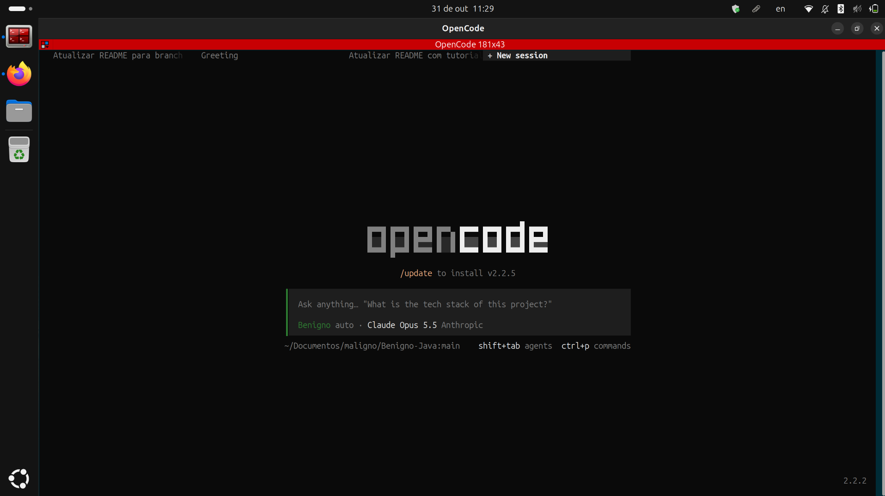

# Usar o Benigno com OpenCode

Guia completo para instalar o OpenCode e usar o Benigno localmente. Para as outras formas de uso, veja o [README](../README.md).

## Passo a passo para usar o Benigno

Não há prompt para colar nem configuração global: o `opencode.json` da raiz define o `benigno` como agente padrão e carrega o plugin `ponytail`, e os agentes ficam em `.opencode/agents/`. O que você precisa fazer manualmente:

### 1. Ter o OpenCode, um modelo de IA, o Git e o JDK
Confira o que já está instalado:
```bash
opencode --version   # precisa ser 2.x
git --version
javac -version       # JDK 8 ou superior
```
Faltou algo? Siga as subseções abaixo. Já tem tudo e um modelo configurado? Pule para o passo 2.

#### 1.1 Instalar o OpenCode V2
- **Linux / macOS / WSL:**
  ```bash
  curl -fsSL https://opencode.ai/v2/install | bash
  ```
  Alternativas: `npm install -g @opencode/cli` (se já tiver Node.js) ou `brew install anomalyco/tap/opencode-v2` (macOS).
- **Windows:** gerenciadores de pacote do Windows não são suportados. Use o **WSL** (comando acima dentro do Ubuntu do WSL), o [binário x64](https://opencode.ai/update/api/latest/cli/opencode/opencode-windows-x64.zip) ou o [app Desktop](https://opencode.ai/update/api/latest/desktop/opencode/opencode-desktop-win-x64.exe).
- **Prefere janela a terminal?** Há o app Desktop para todos os sistemas: links em <https://opencode.ai/v2/docs/>.

Depois de instalar, **feche e abra o terminal** e rode `opencode --version` de novo.

#### 1.2 Conectar um modelo de IA
O Benigno não traz modelo próprio: ele usa o modelo selecionado na sessão do OpenCode. Escolha **uma** opção:

| Opção | Custo | Como fazer |
|---|---|---|
| **Modelos gratuitos do OpenCode** | Grátis (por tempo limitado) | Abra `opencode`, digite `/models` e escolha um modelo com **Free** no nome. Não exige conta. |
| **Conta que você já tem** (Anthropic, OpenAI, Google, GitHub Copilot etc.) | O do seu plano | No OpenCode, digite `/connect`, escolha o provedor e siga o login (OAuth ou chave de API). Depois `/models`. |
| **OpenCode Console / Go** | Pré-pago ou US$ 10/mês | Crie a conta em <https://opencode.ai/console>, depois `/connect` → OpenCode. |
| **Modelo local (Ollama / LM Studio)** | Grátis, roda no seu PC | Instale o [Ollama](https://ollama.com) e rode `ollama pull <modelo>`; o OpenCode detecta sozinho e o modelo aparece em `/models` como `ollama/...`. Exige PC com boa RAM/GPU. |

> Dica: modelos gratuitos e locais pequenos erram mais nas regras do professor. Em trabalho valendo nota, use o modelo mais forte que tiver e peça o `auditor` no final.

Sem abrir a interface, também dá para logar pelo terminal: `opencode auth login`.

#### 1.3 Instalar o Git e o JDK
- **Ubuntu/Debian/WSL:** `sudo apt install git openjdk-17-jdk`
- **macOS:** `brew install git openjdk@17`
- **Windows:** [Git for Windows](https://git-scm.com/download/win) e o JDK da [Adoptium](https://adoptium.net) (marque "Set JAVA_HOME" e "Add to PATH" no instalador).

Sem Git? Baixe o ZIP em <https://github.com/egili/Benigno-Java> (botão **Code → Download ZIP**) e extraia; só não terá `git pull` para atualizar.

### 2. Baixar o repositório
```bash
git clone https://github.com/egili/Benigno-Java.git
cd Benigno-Java
```
Já tem o repositório? Entre na pasta e rode `git checkout main && git pull`. O repositório tem só a branch `main`.

### 3. Abrir o OpenCode DENTRO da pasta do repositório
```bash
cd ~/caminho/para/Benigno-Java
opencode
```
⚠️ Este é o erro mais comum. O OpenCode procura a pasta `.opencode/` no diretório onde foi aberto **e nos diretórios acima**, nunca nos de baixo. Aberto na pasta que *contém* o repositório (ex.: `~/Documentos/maligno` em vez de `~/Documentos/maligno/Benigno-Java`), ele não encontra o Benigno.

### 4. Selecionar o agente
- **Sessão nova**: já abre com o `benigno` (é o `default_agent`).
- **Sessão antiga**: ela guarda o agente com que foi criada. Aperte **Tab** para alternar os agentes primários até aparecer **benigno**, ou abra uma sessão nova.
- O plugin `ponytail` é instalado sozinho na primeira abertura.

Assim deve ficar o OpenCode aberto na pasta certa, com o **Benigno** selecionado (rodapé do campo de texto e caminho terminando em `Benigno-Java:main`):



### 5. Conferir (opcional)
No terminal, dentro da pasta do repositório:
```bash
opencode api get "/api/agent?location%5Bdirectory%5D=$PWD" | grep -o '"id":"[a-z/-]*igno[a-z/-]*"' | wc -l
```
Deve mostrar **39** (o `benigno` + 38 `maligno/*`). Mostrou 0? Volte aos passos 2 e 3.

## Problemas comuns

| Sintoma | Solução |
|---|---|
| `opencode: command not found` | Feche e abra o terminal. Persistiu? O instalador mostra onde pôs o binário; adicione essa pasta ao `PATH`. |
| `opencode --version` mostra `1.x` | Você tem o OpenCode antigo. Reinstale pelo passo 1.1 (o `mise` anterior a 2026.10.9 instala o V1). |
| O Benigno não aparece | Abra o OpenCode **dentro** da pasta do repositório (passo 3). `git branch --show-current` deve mostrar `main` e `git pull` estar em dia; `ls .opencode/agents` deve listar `benigno.md` e a pasta `maligno`. Depois digite `/reload`. |
| Sessão abre com outro agente | Sessão antiga guarda o agente: aperte **Tab** até **benigno** ou abra uma sessão nova. |
| `/models` vazio, sem modelo, ou erro `Model unavailable` | Conecte um provedor com `/connect` (passo 1.2). Se os modelos gratuitos sumiram, veja se a variável `OPENCODE_DISABLE_FREE_MODELS` não está definida. |
| Modelo gratuito lento, fora do ar ou com limite atingido | Eles são por tempo limitado e compartilhados: troque de modelo em `/models`. |
| Ollama não aparece em `/models` | O Ollama precisa estar rodando (`ollama serve`) em `http://127.0.0.1:11434` e com ao menos um modelo baixado (`ollama list`). |
| Erro de login/chave inválida | `opencode auth list` mostra as contas; refaça com `/connect` ou `opencode auth logout` + `opencode auth login`. |
| OpenCode travado ou sem responder | `opencode service restart` e confira com `opencode service status`. |
| Plugin `ponytail` não instala | Ele é baixado na primeira abertura: precisa de internet. Veja o motivo no log (abaixo). |
| `javac: command not found` | Instale o JDK (passo 1.3) e reabra o terminal. No Windows, confira o `PATH`/`JAVA_HOME`. |
| `unmappable character` ou acentos quebrados ao compilar | Compile com `javac -encoding UTF-8 *.java`. |

Qualquer outro erro: veja `~/.local/share/opencode/log/opencode.log` (ou peça ao próprio OpenCode para investigar com o guia <https://opencode.ai/v2/docs/troubleshooting/>).

## Compilação
Como as mensagens de exceção têm acento, compile com `javac -encoding UTF-8 *.java`.

## Outras formas de uso
- [Docker](DOCKER.md): sem instalar OpenCode, Git nem JDK.
- [Cursor](CURSOR.md): usando o Cursor como editor.
